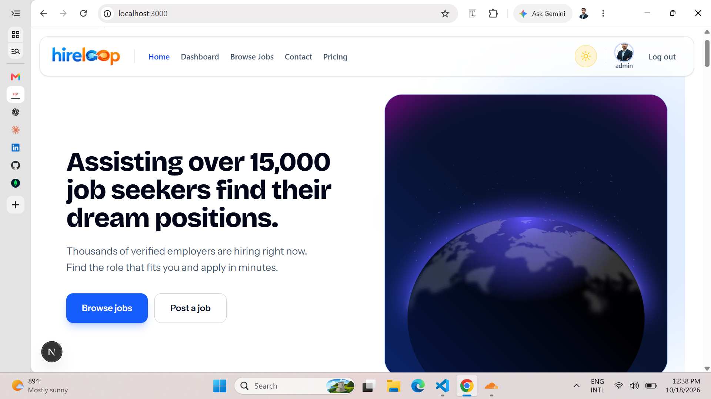
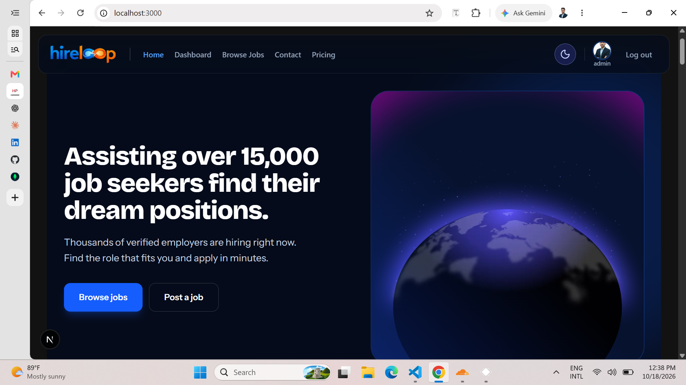
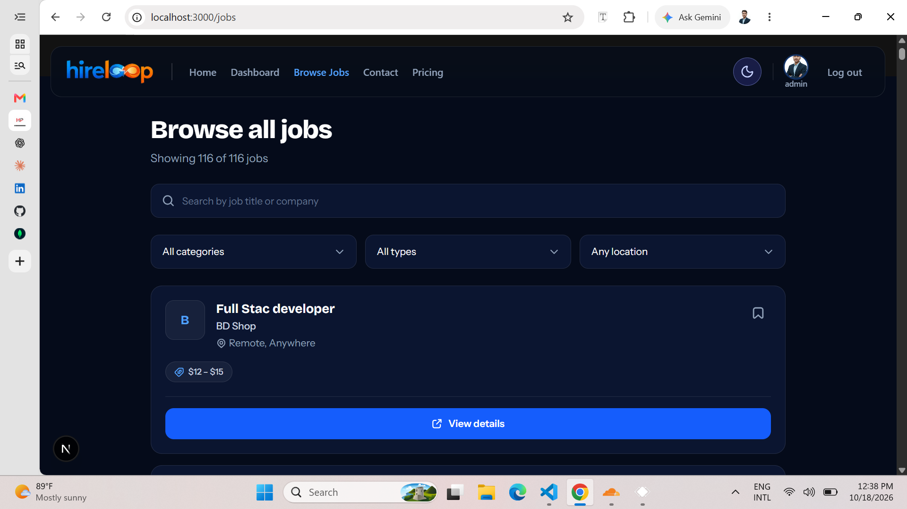
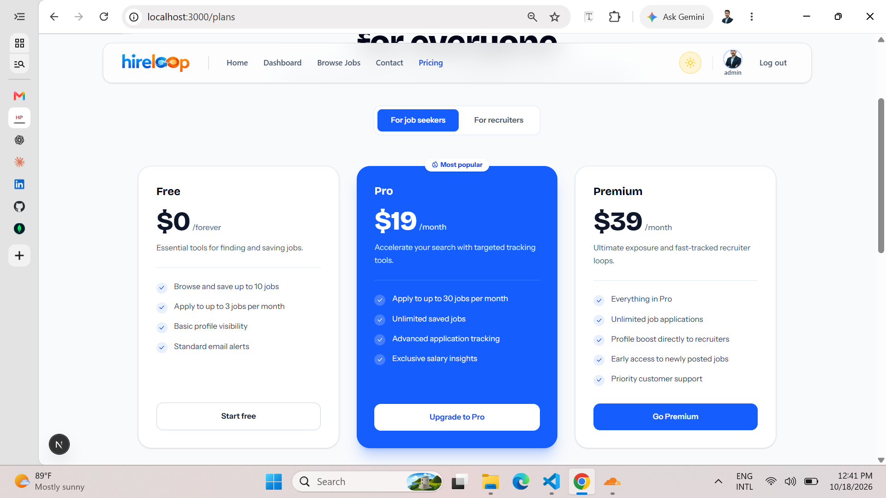

# HireLoop

HireLoop is a full-stack job portal that connects job seekers and recruiters. Job seekers can browse and filter open roles, view job details and apply. Recruiters can post jobs and choose a plan. The interface is fully responsive and supports light and dark mode.

**Live demo:** [your live link]
**Author:** Ahik Rahman

---

## Screenshots

| Home (light) | Home (dark) |
| --- | --- |
|  |  |

| Jobs | Pricing |
| --- | --- |
|  |  |

> Add your own screenshots to a `screenshots` folder and update the file names above.

---

## Features

- **Three user roles:** job seeker, recruiter and admin, with role-aware navigation and a dashboard link for each role
- **Authentication:** email and password sign up and sign in, with a safe redirect back to the page you came from
- **Job browsing:** search by title or company, and filter by category, job type and remote or on-site
- **Job details:** responsibilities, requirements, benefits, salary range and application deadline
- **Apply flow:** seekers must be signed in, and free accounts have a monthly application limit
- **Pricing and checkout:** separate plans for job seekers and recruiters, with Stripe checkout
- **Contact page:** a simple form for questions and support
- **Landing page sections:** video hero, stats banner, browse by category, latest jobs, how it works, features, global talent, success stories, FAQ and a final call to action
- **Design:** blue theme, light and dark mode, and a layout that works from phones to large desktops
- **Accessibility:** labelled form fields, visible keyboard focus, reduced-motion support and semantic HTML

---

## Tech stack

| Area | Technology |
| --- | --- |
| Framework | Next.js (App Router) and React |
| Styling | Tailwind CSS |
| Animation | Framer Motion |
| Icons | @gravity-ui/icons |
| Notifications | react-hot-toast |
| Authentication | Better Auth client |
| Database | MongoDB |
| Payments | Stripe |
| Fonts | Bricolage Grotesque and Instrument Sans (via `next/font`) |

---

## Getting started

### Prerequisites

- Node.js 18 or newer
- A MongoDB database
- A Stripe account (for checkout)

### Installation

```bash
# 1. Clone the repository
git clone [https://github.com/halimaashu/hire-first]
cd hireloop

# 2. Install dependencies
npm install

# 3. Create your environment file
cp .env.example .env.local

# 4. Start the development server
npm run dev
```

Open [http://localhost:3000](http://localhost:3000) in your browser.

### Environment variables

Create a `.env.local` file in the project root:

```env
# Base URL of the app or API (include the protocol)
NEXT_PUBLIC_BASE_URL=http://localhost:3000

# Database
MONGODB_URI=your_mongodb_connection_string

# Authentication
BETTER_AUTH_SECRET=your_long_random_secret
BETTER_AUTH_URL=http://localhost:3000

# Stripe
STRIPE_SECRET_KEY=your_stripe_secret_key
STRIPE_WEBHOOK_SECRET=your_stripe_webhook_secret
```

> Only `NEXT_PUBLIC_BASE_URL` is confirmed in the code. Adjust the other names to match your own setup, and never commit real keys.

---

## Routes

| Route | Description |
| --- | --- |
| `/` | Home page |
| `/jobs` | Browse and filter all jobs |
| `/jobs/[id]` | Job details |
| `/jobs/[id]/apply` | Apply for a job (seekers only) |
| `/plans` | Pricing for job seekers and recruiters |
| `/contact` | Contact form |
| `/signin` | Sign in |
| `/signup` | Create an account |

### API routes

| Route | Description |
| --- | --- |
| `GET /api/allJobs` | Returns all jobs |
| `POST /api/checkout_sessions` | Starts a Stripe checkout session |
| `POST /api/contact` | Receives contact form messages |

---

## Job data shape

```json
{
  "_id": "string",
  "jobTitle": "Senior Product Designer",
  "companyName": "Acme Inc",
  "companyLogo": "https://example.com/logo.png",
  "jobCategory": "design",
  "jobType": "full-time",
  "experienceLevel": "senior",
  "isRemote": true,
  "jobCity": "Dhaka",
  "jobCountry": "Bangladesh",
  "minSalary": 60000,
  "maxSalary": 90000,
  "currency": "USD",
  "deadline": "2026-12-31",
  "responsibilities": "- First item\n- Second item",
  "requirements": "- First item\n- Second item",
  "benefits": "- First item\n- Second item"
}
```

Responsibilities, requirements and benefits are written as `- item` lines and shown as bullet lists on the job page.

---

## Plans

| Plan | Audience | Price | Highlights |
| --- | --- | --- | --- |
| Free | Job seeker | $0 | Save 10 jobs, apply to 3 jobs per month |
| Pro | Job seeker | $19 / month | 30 applications per month, unlimited saved jobs |
| Premium | Job seeker | $39 / month | Unlimited applications, profile boost |
| Free | Recruiter | $0 | 3 active job posts |
| Growth | Recruiter | $39 / month | 10 active job posts, applicant tracking |
| Enterprise | Recruiter | $149 / month | 50 active job posts, analytics, branding |

---

## Roadmap

- [ ] Role-based dashboards for seekers, recruiters and admins
- [ ] Save jobs to the database
- [ ] Recruiter job posting form and applicant management
- [ ] Email notifications for new matches
- [ ] Read the plan from the user's account instead of a fixed free limit

---

## Contributing

Contributions, issues and feature requests are welcome. Fork the repository, create a branch, commit your changes and open a pull request.

---

## License

This project is released under the MIT License.

---

## Author

**Ahik Rahman 💞**

- GitHub: https://github.com/halimaashu
- LinkedIn: https://www.linkedin.com/in/ashkrahman/
- Email: halima520ashu@gmail.com